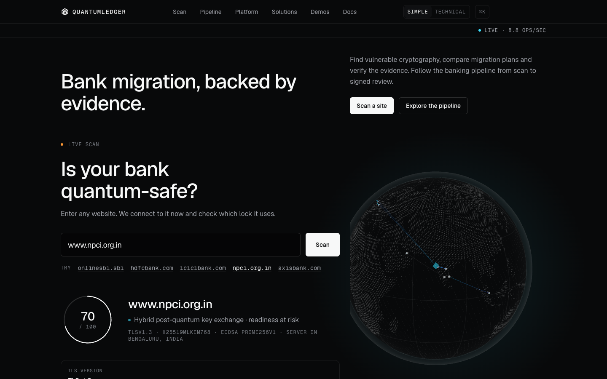

# QuantumLedger

**Post-quantum migration for banks, backed by evidence.** Scan any site's quantum readiness, then plan,
test and prove the move to ML-KEM and ML-DSA with a signed record of every step.



## Quick start

```bash
git clone https://github.com/Yojan-ui/quantumledger.git
cd quantumledger
./start.sh
```

Then open **http://localhost:3000** (`start.sh` opens it for you and prints the URL). No sign-in is needed for
the demo. Ctrl-C stops everything; logs are in `.logs/`.

`start.sh` installs the pnpm dependencies, builds the site once, picks the Python for the pipeline backend
(conda env `pqc` if present, else `qshield/.venv`), builds the demo snapshot with `qshield/run_demo.sh` if
`qshield/out/results.json` is missing, then starts Atlas on **:8100**, the website on **:3000** and the demo
backends (legacy bank :4000, Shield proxies :8443 / :8080). `./start.sh --rebuild` rebuilds the site.

**Requirements:** macOS or Linux (Windows: WSL) · Node.js ≥ 20 (pnpm 10 via `corepack`) · Python 3.12, best as
the conda env from `qshield/environment.yml` (`conda env create -f qshield/environment.yml`), which pins
OpenSSL 3.6.5 with ML-KEM and ML-DSA. Without Python the site still runs; the pipeline pages say the backend is
not running.

## What it does

**1. Live Scan** (home page, first). Type any public domain. One ordinary TLS handshake, offering
X25519MLKEM768 first, gives a 0–100 readiness score and grade, the TLS version, the key exchange (classical or
hybrid post-quantum), the certificate key, signature and expiry, what a quantum computer breaks there, and the
fixes: ML-KEM (FIPS 203) for key exchange, ML-DSA (FIPS 204) for certificates. The score formula is in a
dropdown. Private IPs and localhost are refused; anonymous scans are rate limited. **Send to pipeline**
(operator sign-in) turns the host into real inventory.

**2. The 9-stage pipeline** (Q-Shield Atlas, `qshield/`):

| # | Stage | What it does |
| - | --- | --- |
| 1 | Detect | Finds RSA, ECC and DH in code, configs, certificates and live TLS, with file:line or host evidence |
| 2 | Proof Chain | Signs the Detect evidence with ML-DSA-65 before anything is planned |
| 3 | Plan | Schedules the migration in weekly waves with a QpiAI Opt MILP, compared with FCFS and greedy |
| 4 | Tie-break | Orders equal-score batches in a wave (Mosca margin, HNDL, internet exposure, dependents, effort, id) and picks ML-KEM / ML-DSA |
| 5 | Handshakes | Records real TLS 1.3 handshakes from local lab services (OpenSSL 3.6.5) |
| 6 | Gates | Per wave: post-quantum handshake, downgrade refused, compatibility, tested rollback |
| 7 | QAOA | Cross-checks one week's selection with QAOA against the exact optimum (simulators; one recorded IBM run) |
| 8 | Seal | Signs every result and re-verifies the whole chain |
| 9 | Report | Assembles and validates results.json and an offline report |

## Why banks need it

- **Harvest now, decrypt later:** traffic recorded today under RSA / ECDH can be decrypted once a large
  quantum computer exists ([UK NCSC](https://www.ncsc.gov.uk/whitepaper/next-steps-preparing-for-post-quantum-cryptography)).
- **The standards exist:** NIST published [FIPS 203](https://csrc.nist.gov/pubs/fips/203/final) (ML-KEM),
  [FIPS 204](https://csrc.nist.gov/pubs/fips/204/final) (ML-DSA) and [FIPS 205](https://csrc.nist.gov/pubs/fips/205/final)
  (SLH-DSA) in August 2024; the draft [NIST IR 8547](https://csrc.nist.gov/pubs/ir/8547/ipd) proposes deprecating
  112-bit RSA / ECC after 2030 and disallowing them after 2035.
- **Governance:** RBI's [IT Governance, Risk, Controls and Assurance Practices Directions, 2023](https://www.rbi.org.in/Scripts/NotificationUser.aspx?Id=12562)
  and the [CERT-In section 70B directions](https://www.cert-in.org.in/Directions70B.jsp) set the review context;
  neither is cited here as mandating post-quantum cryptography.

## The math in brief

- **Mosca:** data is exposed if x + y > z (secrecy lifetime + migration time > years to a quantum threat).
  Exposure per system and Q-day scenario: e = max(0, X + t/52 − (Z − start_year)).
- **Plan (MILP):** minimise Σ_s p_s Σ_i r_i e_i,s subject to each system migrating once, weekly effort ≤
  capacity and dependencies first; FCFS (discovery order) and greedy (risk / effort) are scored by the same
  evaluator on the same data.
- **QAOA (simulated):** the week's selection as a QUBO → Ising Hamiltonian, a p-layer ansatz, and the
  approximation ratio = best feasible sampled objective / exact optimum. No quantum advantage is claimed.
- **Hash chains:** the Atlas ledger links entries with SHA-256 (prev_hash) and an RFC 6962 Merkle root; the
  website's Proof Chain demo uses a SHA3-256 hash chain. Entries are signed with **ML-DSA-65** (FIPS 204).
- **ML-KEM / ML-DSA:** hybrid X25519MLKEM768 for key exchange, ML-DSA for signatures; both → ML-KEM first.

## Architecture

```text
browser ──> Next.js UI (q-setu/apps/web, :3000)
              └─ /atlas-api/* proxy (same origin; cookies, CSRF and SSE passed through)
                    └─> Q-Shield Atlas Python backend (qshield/atlas_web, :8100)
                          └─ detect → ledger → schedule → tiebreak → capture → gates → qaoa → seal → report
                             (one subprocess per step; ML-DSA-65 signed ledger; results.json)
```

## Pages to open

| Page | What you see |
| --- | --- |
| `/` and `/#scan` | The live scan, then the pipeline preview |
| `/diagnostics?ws=demo` | The pipeline HUD: press **Space** to replay the recorded run in the terminal and the 3D view |
| `/atlas/demo` | Every stage's results, with "the math behind it" in each stage's Details |
| `/platform` | The adapters (Shield, Web, SDK, Edge, Vault) and the shared core |

**Operator account** (only for Send to pipeline and live runs):

```bash
cd qshield && conda activate pqc && python -m atlas_web create-user --username demo-op --role operator
```

## Honesty note

- **Live:** the website scan (one real TLS handshake), Send to pipeline runs, and operator pipeline runs.
- **Recorded:** the bank demo is a fictional bank (`qshield/detect/fixtures/mock_bank`) with a real local scan
  and real local TLS lab handshakes; the diagnostics replay plays that recorded run from `results.json`.
- **Simulated / assumptions:** QAOA runs on simulators (plus one recorded IBM ibm_fez run, labelled); shelf
  lives, risk weights, effort, capacity and Q-day years are labelled assumptions in `qshield/config/`. Lab gate
  results apply to the lab, never to a scanned public host (those stay `not_verified_in_lab`).

Also in this repo: **AetherPool** (`engine/`, `backend/`, `frontend/`), a PQC-gated trading venue; run it with
`scripts/dev.sh` (see `docs/AETHERPOOL.md`).
