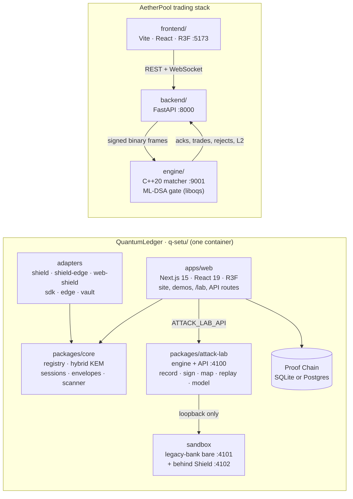

# QuantumLedger

**Scan, shield and prove: post-quantum security for websites, payments and trading, measured live,
never quoted.**

This repository holds two working systems built on NIST's post-quantum standards:

- **QuantumLedger** (`q-setu/`): a website, platform and SDK family.
  - It finds quantum-vulnerable cryptography and swaps in hybrid ML-KEM / ML-DSA without a rewrite.
  - It puts **Shield** (post-quantum TLS plus AI-agent defence) in front of any site.
  - The **Attack Lab** records, signs and replays every attack Shield flags.
  - It anchors the proof in a signed, hash-chained ledger.
- **AetherPool** (`engine/`, `backend/`, `frontend/`, `scripts/`): an institutional trading venue.
  A C++ matching engine accepts an order only if it carries a valid ML-DSA signature.

## What's new in this version

- **Attack Lab** (`q-setu/packages/attack-lab`, and `/lab` on the website).
  - It records every request Shield's risk engine flags and signs each record with ML-DSA-65.
  - It chains the records into tamper-evident incidents.
  - It maps each attack step by step, groups attacks into named patterns, and replays them against a
    local sandbox.
- **A trained threat model.** The Lab scores traffic with a model trained on a cleaned sample of the
  CSIC 2010 dataset plus the Lab's own evidence. It scores about 90% on held-back requests, and the
  `/lab/model` page shows what it learned and where it falls short.
- **Real scans for any site.** From the Lab you can check a public website (TLS, post-quantum key
  exchange, security headers, exposed login and API links) or an email domain (MX, SPF, DKIM, DMARC).
  These checks are passive and read-only; no attack traffic is ever sent.
- **Resilience benchmark** (`/lab/benchmark`). Five of our own attacker agents run the same plan
  against two local sandbox copies of the demo bank app: one bare, one behind PQC + Shield. The
  signed report shows what was blocked, and also what still got through.
- **Signed-in Lab.** Any email can sign in. Demo accounts see a team view or a single customer's view.
- **One-container deploy.** A Docker image on Node 24 (OpenSSL 3.5, for X25519MLKEM768) runs the
  website and the Attack Lab engine together. `render.yaml` deploys it to Render.
- **Faster, calmer site.** The home page is regrouped into four chapters and loads its 3D stage after
  first paint (243 KB initial JS, budget 250 KB). Motion is slower and calmer.
- **Security fixes.** Next.js 15.5.28 fixes a critical advisory, zod and body-parser are upgraded,
  and `pnpm audit --audit-level high` is clean.

## What problem it solves

Card payments, UPI, net banking and trading systems are protected by RSA and elliptic-curve
cryptography (ECDH, ECDSA). A large quantum computer running **Shor's algorithm** could break both.

- **Harvest now, decrypt later.** Traffic recorded today under RSA/ECDH can be opened once that
  machine exists. Account data and transaction histories stay sensitive for years.
- **Forgery later.** Once ECDSA and RSA signatures can be forged, a signed payment or trade order
  proves nothing.
- **Migration is slow.** Mosca's rule: if _shelf life + migration time > time until Q-Day_, you are
  already late.

NIST standardised the replacements in 2024: **ML-KEM** (FIPS 203) for key exchange and **ML-DSA**
(FIPS 204) for signatures. QuantumLedger uses real operations to find the vulnerable cryptography,
replace it, defend the site and prove all of it.

## Key features

- **Real crypto everywhere.** Every handshake, signature, ledger append and latency on screen is a
  real operation on the running machine. Anything simulated is labelled "(sim)" or "estimate".
- **Readiness scanner.** It scores a config, certificate, source file or live website (a real TLS
  probe), and exports a CycloneDX 1.6 **CBOM** and an ordered migration plan.
- **Shield.** Shield Edge terminates TLS 1.3 with **X25519MLKEM768** using native OpenSSL 3.5. Its
  defence engine scores behaviour per IP, network block and session, then escalates: rate limit, then
  proof-of-work challenge, then block. Honeypots, a trap link and canary keys catch AI agents and
  scrapers.
- **Attack Lab.** Detect, record, sign, map, group into patterns, then replay. Replays and test
  traffic go to loopback only: a host guard refuses every other address.
- **Five adapters, one core** (`q-setu/packages/`): Shield (zero-code sidecar), Web (script tag +
  Service Worker), SDK (ESM), Edge (IoT profile) and Vault (data at rest).
- **Proof Chain.** An append-only, SHA3-256 hash-chained ledger signed with ML-DSA-65. Edit one row in
  the database and verification names the entry that was changed.
- **A PQC-gated matching engine** (AetherPool). It checks every order's ML-DSA signature, key
  fingerprint, timestamp and replay counter before matching. Eight live attack types are each
  rejected with a reason.

### Where to look

| Where                     | What you see                                                                                              |
| ------------------------- | --------------------------------------------------------------------------------------------------------- |
| `/`                       | The home page in four chapters. Scan any site and watch the globe.                                        |
| `/lab`                    | Attack Lab: scan a site, incidents, attack map, patterns, replay, the threat model and the benchmark.     |
| `/shield`, `/shield/live` | Shield, and a live run of the same attacks against the bank app with and without Shield Edge.             |
| `/demo/how-it-works`      | X25519 + ML-KEM in your browser tab; a swapped server key is rejected by ML-DSA.                          |
| `/demo/deploy`            | The five adapters going live across a sector's systems on a 3D globe.                                     |
| `/demo/qday`              | Recorded traffic before and after Q-Day: classical records open, QuantumLedger records stay sealed.       |
| `/demo/ledger`            | Tamper with entry #42 in the database, then verify: the chain breaks exactly there.                       |
| `/diagnostics`            | The five-stage pipeline: detect → score → defend → prove → rescan.                                        |
| `/pitch`                  | Seven slides (←/→). Add `?present=1` to any page for presenter mode.                                      |
| AetherPool UI `:5173`     | The PQC dark-pool terminal: liquidity surface, depth ladder, FIX tape, wire inspector and attack console. |

## Architecture



| Part                               | What it does                                                                                                                                                                                              |
| ---------------------------------- | --------------------------------------------------------------------------------------------------------------------------------------------------------------------------------------------------------- |
| **`q-setu/apps/web`**              | The website, the four demos, the scanner, the Shield dashboard (`/app`), the signed-in Lab (`/lab`) and every API route.                                                                                  |
| **`q-setu/apps/attack-lab-ui`**    | A standalone Attack Lab dashboard for local use (`:3100`).                                                                                                                                                |
| **`q-setu/apps/legacy-bank`**      | An untouched "legacy" Express app. It's what Shield protects in the demos and what the Lab's sandbox runs.                                                                                                |
| **`q-setu/packages/attack-lab`**   | The Lab engine: detection hook, append-only signed record store, timelines, patterns, replay, threat model and benchmark. See its [README](q-setu/packages/attack-lab/README.md).                         |
| **`q-setu/packages/shield*`**      | `shield` (middleware and signed manifest), `shield-edge` (PQ-TLS reverse proxy), `shield-guard` (defence engine), `shield-proxy` (sidecar tunnel).                                                        |
| **`q-setu/packages/*`**            | `core`, `sdk`, `web-shield`, `edge`, `vault`, and `sim` (network and adversary simulations).                                                                                                              |
| **`engine/`** (C++20)              | AetherPool's matching engine. Orders pass the PqcEngine gate (policy → participant → key fingerprint → timestamp → ML-DSA verify → replay check) before reaching a lock-free L3 price-time book.          |
| **`backend/`** (Python, FastAPI)   | Bridges engine and browser: 16 desks with ML-DSA keys, signed order flow, an adversary with 8 attacks, a harvest-now-decrypt-later simulation, and the QuantumLedger auditor (CBOM and Merkle proof log). |
| **`frontend/`** (TypeScript, Vite) | The AetherPool trading terminal.                                                                                                                                                                          |

More detail: [`q-setu/README.md`](q-setu/README.md) (the platform, Shield, the live backend, what's
real and what's simulated) and [`docs/AETHERPOOL.md`](docs/AETHERPOOL.md) (the trading stack,
benchmarks and attack table).

## Tech stack

| Area         | Stack                                                                                                                                                        |
| ------------ | ------------------------------------------------------------------------------------------------------------------------------------------------------------ |
| Web platform | Next.js 15, React 19, TypeScript, Tailwind (token-only design system), React Three Fiber 9, GSAP + Lenis, Zod, SQLite or Postgres (Drizzle), pnpm workspaces |
| Crypto       | `@noble/post-quantum`, `@noble/curves`, `@noble/hashes`, `@noble/ciphers`; native OpenSSL 3.5 (Node 24) for Shield Edge's X25519MLKEM768                     |
| Testing      | Vitest (249 tests), Playwright, Lighthouse CI, a bundle budget and a Shield Edge performance budget                                                          |
| Engine       | C++20, CMake ≥ 3.21, liboqs 0.14.0, OpenSSL 3 (optional classical baseline)                                                                                  |
| Backend      | Python ≥ 3.11, FastAPI, Uvicorn, `cryptography`, liboqs through `libaetherpqc` (ctypes)                                                                      |
| Trading UI   | Vite 5, React 18, TypeScript, React Three Fiber 8, Tailwind 3                                                                                                |

### Algorithms

| Algorithm                   | Standard                | Used for                                                                                     |
| --------------------------- | ----------------------- | -------------------------------------------------------------------------------------------- |
| **ML-KEM-512 / 768 / 1024** | FIPS 203                | Key exchange, always hybridised with X25519. 768 by default, 512 for the Edge (IoT) profile. |
| **ML-DSA-44 / 65 / 87**     | FIPS 204                | Handshakes, ledger entries, Attack Lab evidence, Vault records and every AetherPool order.   |
| **X25519MLKEM768**          | IETF hybrid TLS group   | Shield Edge's TLS 1.3 key exchange; the scanner detects it on live sites.                    |
| SLH-DSA-SHA2-128f           | FIPS 205                | An alternative signature in the crypto-agile registry.                                       |
| X25519 + HKDF, AES-256-GCM  | RFC 7748/5869, FIPS 197 | The classical half of every hybrid, and every message after the handshake.                   |
| SHA3-256 / SHA-256          | FIPS 202 / 180-4        | Ledger hash chain, Merkle trees, the Attack Lab record chain.                                |

## Setup and run

### Prerequisites

- **Node.js ≥ 24** and **pnpm 10** (`corepack enable` picks up the pinned version) for `q-setu/`.
  Node 24 ships OpenSSL 3.5, which X25519MLKEM768 needs.
- For AetherPool: Node ≥ 18, Python ≥ 3.11, a C++20 compiler and CMake ≥ 3.21 (OpenSSL 3 optional).

### Run QuantumLedger

```bash
cd q-setu
corepack enable
pnpm install
pnpm dev:web      # the site and all demos on http://localhost:3000
pnpm demo         # production build + the Attack Lab engine with demo data, on :3000
```

`pnpm demo` signs in to `/lab` without a password using demo accounts:
`team@quantumledger.dev` (team view), `ciso@ledgerwood.example` and `it@sahyadri.example` (one
customer each).

Other commands:

```bash
pnpm dev                                    # site + legacy bank + both Shield sidecars
pnpm --filter @qsetu/attack-lab-ui dev      # standalone Attack Lab: API :4100, dashboard :3100
pnpm test                                   # unit and integration tests (Vitest)
pnpm lint && pnpm typecheck
pnpm build && pnpm test:e2e                 # Playwright end-to-end tests
pnpm check:budget                           # home page initial JS ≤ 250 KB gzip
```

Everything has a working local default. Copy `q-setu/apps/web/.env.example` to
`q-setu/apps/web/.env.local` to change anything.

### Run AetherPool

```bash
export OPENSSL_ROOT_DIR="$(brew --prefix openssl@3)"   # optional
./scripts/dev.sh                                        # engine :9001, backend :8000, UI :5173
```

See [`docs/AETHERPOOL.md`](docs/AETHERPOOL.md) to build and run each tier on its own.

## Deploy

QuantumLedger needs a long-running server, not serverless. Raw TLS scans, the SSE event bus, the live
mesh, the Shield demo nodes and the Attack Lab engine all need a persistent process. The Docker image
runs the website and the Lab engine together, and the container exits if either one stops.

**Render (one click):**

1. **New → Web Service → Build and deploy from a Git repository**, then pick this repo.
2. Render reads [`render.yaml`](render.yaml): Docker runtime, root `q-setu`, a 1 GB disk at `/data`,
   health check `/api/health`.
3. `QSETU_KMS_KEK` is generated by Render on the first deploy. Nothing secret is stored in the repo.

**Any Docker host:**

```bash
cd q-setu
docker build -t q-setu .
docker run -p 3000:3000 -v qsetu-data:/data \
  -e QSETU_KMS_KEK=$(openssl rand -hex 32) \
  -e LAB_DEMO_ACCOUNTS=team@quantumledger.dev=team \
  q-setu
```

| Variable                              | Purpose                                                                          |
| ------------------------------------- | -------------------------------------------------------------------------------- |
| `QSETU_KMS_KEK`                       | 64 hex chars; wraps every KMS key. Keep it secret and stable.                    |
| `QSETU_DATA_DIR`, `ATTACK_LAB_DIR`    | Where the ledger, keys and Lab evidence live (`/data` in the image).             |
| `ATTACK_LAB_API`, `LAB_PORT`          | Where the website reaches the Lab engine (`http://127.0.0.1:4100` in the image). |
| `ATTACK_LAB_TOKEN`                    | Optional shared token so only the website can call the Lab API.                  |
| `LAB_DEMO_ACCOUNTS`                   | Passwordless demo sign-ins for `/lab` (not secrets).                             |
| `DATABASE_URL`                        | Optional `postgres://` URL; otherwise SQLite in `QSETU_DATA_DIR`.                |
| `ADMIN_PASSWORD`, `ADMIN_TOTP_SECRET` | Admin sign-in for `/admin` and resetting the demos.                              |

CI (`.github/workflows/q-setu-ci.yml`) runs lint, typecheck, unit tests, the build, the bundle budget,
the Shield Edge performance budget, Playwright, Lighthouse, a dependency audit, a gitleaks secret
scan, an SBOM and CodeQL.

## Honest scope

- Certificates stay ECDSA, because browsers don't accept post-quantum certificates yet. The hop from
  Shield Edge to your origin is only as strong as that hop's own TLS.
- The Attack Lab observes and replays. It never attacks anyone else's systems: replays go only to
  loopback sandboxes, and site scans are passive.
- The benchmark reports what still gets through. Nothing here makes a site impossible to attack.
- The Q-Day demo factors a deliberately tiny RSA key and uses a labelled oracle in place of Shor's
  algorithm. The AES and ML-KEM operations are real.
- Demo institutions and people are fictional. The full list of what's real and what's simulated is in
  [`q-setu/README.md`](q-setu/README.md#whats-real-and-whats-simulated).

## Project structure

```text
.
├── README.md
├── render.yaml                # Render: one Docker web service from q-setu/
├── .github/workflows/         # q-setu CI and the ZAP baseline
├── docs/AETHERPOOL.md         # AetherPool reference
├── engine/  backend/  frontend/  scripts/   # AetherPool
└── q-setu/                    # QuantumLedger (pnpm monorepo)
    ├── Dockerfile             # Node 24 image: website + Attack Lab engine
    ├── apps/
    │   ├── web/               # Next.js site, demos, /lab, /shield, API routes
    │   ├── attack-lab-ui/     # standalone Attack Lab dashboard
    │   └── legacy-bank/       # unmodified "legacy" app for Shield and the sandbox
    ├── packages/
    │   ├── attack-lab/        # record, sign, map, pattern, replay, model, benchmark
    │   ├── core/              # registry, hybrid KEM, sessions, envelopes, scanner
    │   ├── shield/  shield-edge/  shield-guard/  shield-proxy/
    │   ├── web-shield/  sdk/  edge/  vault/
    │   └── sim/               # network and adversary simulations
    ├── tests/e2e/             # Playwright end-to-end tests
    └── scripts/               # dev, demo, benchmarks, design lint, audits
```
