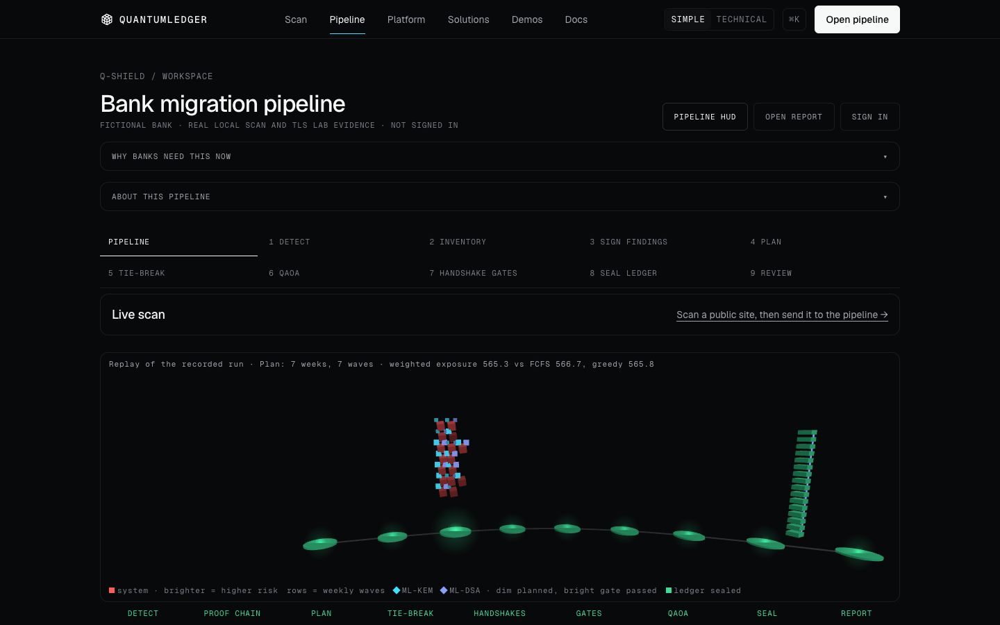
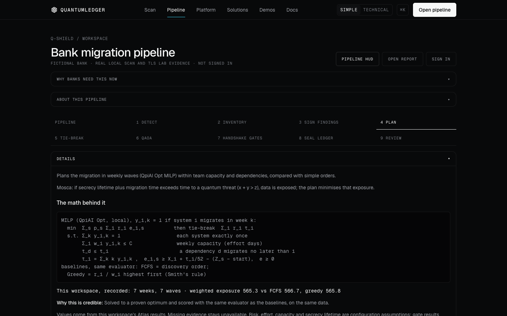
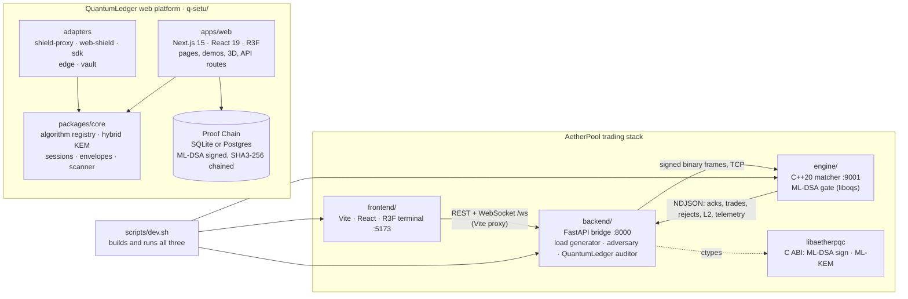

# QuantumLedger

**Scan any site for quantum risk, then plan, test and prove the migration to post-quantum cryptography.**


## Run it (one command)

```bash
git clone https://github.com/Yojan-ui/quantumledger.git
cd quantumledger
./start.sh
```

That's it. `start.sh` installs what's missing, builds the site once (a few minutes the first time), starts
everything and **opens http://localhost:3000** in your browser. Ctrl-C stops it all. Logs are in `.logs/`.

| What starts | Port |
| --- | --- |
| QuantumLedger website (Next.js production build) | **3000** |
| Q-Shield Atlas pipeline backend (`qshield/`) | 8100 |
| Demo backends: legacy bank, Shield proxies | 4000, 8443, 8080 |

**Needs:** Node.js 20+ (pnpm comes via corepack). For the pipeline backend: Python 3.12, ideally the conda env
`pqc` (`conda env create -f qshield/environment.yml`, which brings OpenSSL 3.6.5 with ML-KEM / ML-DSA).
Without Python the site still runs and the pipeline pages say the backend is not running.
macOS or Linux (Windows: use WSL). `./start.sh --rebuild` rebuilds after you change the code.

**Operator account** (only for "Send to pipeline" and running pipelines; scanning needs no sign-in):

```bash
cd qshield && conda activate pqc && python -m atlas_web create-user --username demo-op --role operator
```

## What you'll see

1. **Scan** (home page, first). Type any public domain: one ordinary TLS handshake, no sign-in. You get a
   0–100 readiness score and grade; the TLS version, key exchange (classical or hybrid X25519MLKEM768),
   certificate algorithm and expiry; what a quantum computer breaks there; and the ML-KEM (FIPS 203) /
   ML-DSA (FIPS 204) fixes. The score formula is in a dropdown. Private IPs and localhost are refused; scans
   are rate limited (6/min and 30/h per client IP behind a trusted proxy, `QSETU_TRUST_PROXY=1`; 30/min and
   300/h server-wide). Pre-scanned results answer if the network is down.
2. **Send to pipeline** (operator sign-in). The host becomes real inventory in a new Atlas workspace.
3. **Pipeline** (`/atlas/demo`, second in the nav). Detect → Proof Chain → Plan (QpiAI Opt MILP vs FCFS and
   greedy) → Tie-break (ML-KEM / ML-DSA patch order) → Handshake gates on real TLS 1.3 → QAOA cross-check →
   Seal (ML-DSA-65) → Report, as a 3D view driven by the run's events. Each stage's Details has the math
   behind it; "Why banks need this now" cites NIST, RBI and CERT-In primary sources.

| | |
| --- | --- |
|  |  |
| *The pipeline in 3D (replay of a recorded run)* | *The math behind each stage, with recorded numbers* |

This repository also holds **AetherPool** (`engine/`, `backend/`, `frontend/`), a PQC-gated trading venue,
started separately with `scripts/dev.sh` (see below).

## What problem it solves

Card payments, UPI, net banking and trading systems are protected by RSA and elliptic-curve
cryptography (ECDH, ECDSA). Both rest on maths problems that ordinary computers can't solve in any
useful time. A large quantum computer running **Shor's algorithm** could.

That machine doesn't exist yet, but the threat has already started:

- **Harvest now, decrypt later.** An attacker can record encrypted traffic today and keep it until a
  quantum computer can open it. Account data, transaction histories and identity records stay sensitive
  for years, so anything sent today under RSA/ECDH is already exposed.
- **Forgery later.** Once ECDSA and RSA signatures can be forged, a signed payment instruction or trade
  order proves nothing.
- **Migration is slow.** Large organisations take years to replace cryptography. Mosca's rule says that
  if *shelf life + migration time > time until Q-Day*, you are already late.

In 2024 NIST standardised the replacements: **ML-KEM** (FIPS 203) for key exchange and **ML-DSA**
(FIPS 204) for signatures. QuantumLedger shows, with real operations, how to find the vulnerable
cryptography, replace it and prove that you did.

## Key features

- **Real crypto everywhere.** Every handshake, signature, verification, ledger append and latency on
  screen is a real operation on the running machine. Anything simulated is labelled "(sim)" or
  "estimate".
- **Readiness scanner.** It scores a config, certificate, source file or live website (a real TLS probe).
  It exports a CycloneDX 1.6 **CBOM** and an ordered migration plan.
- **Five adapters, one core** (`q-setu/packages/`):
  - **Shield**: a zero-code sidecar proxy
  - **Web**: a script tag plus a Service Worker
  - **SDK**: an ESM package
  - **Edge**: an IoT profile
  - **Vault**: data at rest
- **Proof Chain.** An append-only, SHA3-256 hash-chained ledger signed with ML-DSA-65, with signed
  checkpoints. Edit one row in the database and verification pinpoints it.
- **A PQC-gated matching engine** (AetherPool):
  - an L3 price-time order book, zero-allocation on the hot path
  - every order's ML-DSA signature, key fingerprint, timestamp and replay counter checked before
    matching
  - eight live attack vectors, every one rejected with a reason
- **Harvest-now-decrypt-later simulation.** Recorded X25519 traffic opens once Q-Day is simulated (an
  oracle stands in for Shor's algorithm, labelled). The ML-KEM traffic stays sealed.

### Demos

| Where | Demo | What you see |
| --- | --- | --- |
| Web app `/demo/how-it-works` | Hybrid handshake | X25519 + ML-KEM in your browser tab, merged through HKDF. Then an attacker swaps the server's key and the ML-DSA check rejects it. |
| Web app `/demo/deploy` | Deploy anywhere | The five adapters going live across a sector's systems on a 3D globe. |
| Web app `/demo/qday` | Q-Day time machine | Recorded traffic before and after Q-Day: classical records open, QuantumLedger records stay sealed. Real tiny-RSA breaking in the browser. |
| Web app `/demo/ledger` | Proof Chain | Tamper with entry #42 in the database, then verify: the chain breaks exactly there. Click any block to open its entry and signature. |
| Web app `/demo/scanner` | Readiness scanner | Score pasted config or code, or a live site; download the CBOM. |
| Web app `/diagnostics` | Five-stage pipeline | Harvesting → shelf life (Mosca) → lattice patch → anchored → verified, as a 3D stage driven by real results. |
| AetherPool UI `:5173` | PQC dark-pool terminal | A live liquidity surface, depth ladder, FIX tape, wire inspector, attack console, HNDL terminal, and the QuantumLedger CBOM / remediation / proof-ledger tabs. |

The four film demos (handshake, deploy, Q-Day, Proof Chain) each have one **Try it** button that runs
the demo's real sequence. Press **?** anywhere for keyboard shortcuts.

## Architecture



| Part | What it does |
| --- | --- |
| **`engine/`** (C++20) | The matching engine process. An ingress thread decodes binary order frames and passes each one through the **PqcEngine** gate: algorithm policy → known participant → constant-time key-fingerprint check → timestamp window → ML-DSA verify over a SHA3-256 order digest → per-participant replay check. Verified orders go through a lock-free SPSC ring to the matcher thread (fixed-point L3 book, FIFO per price level, O(1) best price). Fills, rejects and 10 Hz depth snapshots stream out as NDJSON on TCP `127.0.0.1:9001`. It also builds `libaetherpqc` (a C ABI for signing and KEM) and benchmarks ML-DSA/ML-KEM against ECDSA, RSA and ECDH. |
| **`backend/`** (Python, FastAPI) | The bridge between engine and browser. It provisions 16 trading desks with ML-DSA-65/87 keys, generates signed order flow (0–2,000 msg/s), runs an adversary (wire tap plus 8 attacks: ECDSA, tamper, forge, spoof, replay, stale, downgrade, rogue), and simulates harvest-now-decrypt-later over captured frames. `quantumledger.py` is the auditor: a CycloneDX CBOM, X25519MLKEM768 + ML-DSA-65 remediation evidence, and an RFC 6962 Merkle proof log signed with Ed25519 and ML-DSA-65. It serves `/ws` and REST on `:8000`. |
| **`frontend/`** (TypeScript, Vite) | The trading terminal. It shows a 3D liquidity surface, depth ladder, FIX 5.0 tape, byte-level wire inspector, a network profiler (one signed order as packets at MTU 1500/9000), PQC panels and the QuantumLedger views. In dev it proxies `/api` and `/ws` to the backend. |
| **`scripts/`** | `dev.sh` builds the engine if needed, creates the backend venv and installs the UI's packages, then starts engine, backend and UI together (Ctrl-C stops all three). |
| **`q-setu/`** (pnpm monorepo) | The QuantumLedger website and platform: `apps/web` (Next.js site, demos, API routes and Proof Chain), `apps/legacy-bank` (an untouched "legacy" app for the Shield demo), `packages/*` (the core and the five adapters), and the tests and audit scripts. Its own [README](q-setu/README.md) has the details. |

The AetherPool stack has a detailed reference, with measured benchmarks and a "what is real vs
simulated" list, in [`docs/AETHERPOOL.md`](docs/AETHERPOOL.md).

## Tech stack

| Area | Stack |
| --- | --- |
| Web platform | Next.js 15, React 19, TypeScript, Tailwind (token-only design system), React Three Fiber 9 + drei (one shared WebGL canvas), GSAP + Lenis, Zod, SQLite (`better-sqlite3`) or Postgres, Vitest, Playwright, pnpm workspaces |
| Web crypto | `@noble/post-quantum`, `@noble/curves`, `@noble/hashes`, `@noble/ciphers` (audited, pure TypeScript), in Web Workers in the browser |
| Engine | C++20, CMake ≥ 3.21, liboqs 0.14.0 (fetched at configure time, ML-KEM/ML-DSA only), OpenSSL 3 (optional classical baseline) |
| Backend | Python ≥ 3.11, FastAPI, Uvicorn, `cryptography`, `orjson`, liboqs through `libaetherpqc` (ctypes) |
| Trading UI | Vite 5, React 18, TypeScript, React Three Fiber 8, Tailwind 3 |

### Post-quantum and classical algorithms

| Algorithm | Standard | Used for |
| --- | --- | --- |
| **ML-KEM-512 / 768 / 1024** | FIPS 203 | Key exchange. 768 is the default; 512 is the Edge (IoT) profile, 1024 the maximum level. Always hybridised with X25519. |
| **ML-DSA-44 / 65 / 87** | FIPS 204 | Signatures on handshakes, ledger entries, checkpoints, Vault records and every AetherPool order (65 by default; 87 can be enforced by policy, and downgrades are rejected). |
| **X25519MLKEM768** | IETF hybrid TLS group | AetherPool remediation evidence. The web scanner also detects it on live sites. |
| SLH-DSA-SHA2-128f | FIPS 205 | Registered in the core's crypto-agile registry as an alternative signature. |
| X25519 + HKDF-SHA-256 | RFC 7748 / 5869 | The classical half of every hybrid; both secrets are merged into one key. |
| AES-256-GCM | FIPS 197 / SP 800-38D | Every message after the handshake, and Vault records. |
| SHA3-256 | FIPS 202 | Ledger hash chain, Merkle trees, the AetherPool order digest. |
| Ed25519, ECDSA-P256, RSA-2048, ECDH-P256 | (classical) | Baselines for comparison, and the dual-signed Merkle root. |

## Setup and run

### Prerequisites

- **Node.js ≥ 20** and **pnpm 10** (`corepack enable` provides the pinned pnpm) for `q-setu/`
- **Node.js ≥ 18** and npm for `frontend/`
- **Python ≥ 3.11** for `backend/`
- **A C++20 compiler** (Xcode command-line tools on macOS) and **CMake ≥ 3.21** (`pip install cmake`
  or `brew install cmake`) for `engine/`
- Optional: **OpenSSL 3** (`brew install openssl@3`) for the classical baseline numbers

### Environment variables

Both parts run with no configuration. Copy the examples only to change the defaults:

```bash
cp .env.example .env                                  # AetherPool: engine host/port, library path, OpenSSL
cp q-setu/apps/web/.env.example q-setu/apps/web/.env  # Web app: site URL, database, KMS key, admin, email
```

The AetherPool processes read plain environment variables, so load `.env` into your shell before
starting them: `set -a; . ./.env; set +a`. Next.js reads `q-setu/apps/web/.env` by itself. In
production, set `QSETU_KMS_KEK` (`openssl rand -hex 32`) so the key-encryption key isn't kept in a
file on the server.

### Run the QuantumLedger web platform by hand

```bash
cd q-setu
corepack enable                   # once: uses the pnpm version pinned in package.json
pnpm install
pnpm dev:web                      # http://localhost:3000 (the site and all demos)
# or, with the Shield demo's legacy bank and the two sidecar proxies as well:
pnpm dev
```

Production build and checks:

```bash
pnpm build && pnpm start          # production server on :3000
pnpm test                         # unit and integration tests (Vitest)
pnpm lint:design                  # design-token lint
pnpm test:e2e                     # Playwright end-to-end tests
```

### Run the AetherPool trading stack

One command builds whatever is missing and starts all three tiers:

```bash
export OPENSSL_ROOT_DIR="$(brew --prefix openssl@3)"   # optional
./scripts/dev.sh                                        # engine :9001, backend :8000, UI :5173
open http://127.0.0.1:5173
```

Or start each tier yourself:

```bash
# 1. Engine (the first configure downloads liboqs 0.14.0, about a minute)
cmake -S engine -B engine/build -DCMAKE_BUILD_TYPE=Release
cmake --build engine/build -j
ctest --test-dir engine/build --output-on-failure    # order book and PQC-gate tests
./engine/build/aether_engine                          # listens on 127.0.0.1:9001

# 2. Backend
cd backend
python3 -m venv .venv && .venv/bin/pip install -r requirements.txt
.venv/bin/uvicorn main:app --host 127.0.0.1 --port 8000
curl http://127.0.0.1:8000/api/health                 # {"engine_connected":true,...}

# 3. Trading UI
cd frontend && npm install && npm run dev             # http://127.0.0.1:5173
```

Start the engine before the backend: the backend connects to it on startup and needs
`engine/build/libaetherpqc` for signing.

## Q-Shield pipeline

The `/atlas` pages and the `/diagnostics?ws=<workspace>` HUD mode run
[Q-Shield Atlas](qshield/README.md) (imported in `qshield/` with its history). Atlas finds RSA / ECC / DH in
a codebase, plans the migration with a QpiAI Opt MILP, gates each wave on real TLS 1.3 handshakes, and
signs every result into an ML-DSA-65 Proof Chain. The pages use Quantum Ledger's UI; the pipeline and its
data are Atlas's.

**Start both** (two terminals, or `pnpm dev` from `q-setu/`, which now also starts Atlas as `atlas`):

```bash
# once: conda env pqc (Python 3.12 + OpenSSL 3.6.5, see qshield/README.md), a user, the demo snapshot
cd qshield && conda activate pqc && pip install -r requirements.txt
python -m atlas_web create-user --role operator   # no default user
./run_demo.sh --no-open                           # builds the public read-only `demo` workspace (local only)

# terminal 1: Atlas backend on :8100
cd q-setu && pnpm dev:atlas                       # = qshield/run.sh --no-browser

# terminal 2: Quantum Ledger web on :3000
cd q-setu && pnpm dev:web                         # or: pnpm build && pnpm start
open http://localhost:3000/atlas
```

`ATLAS_URL` (default `http://127.0.0.1:8100`, see `apps/web/.env.example`) tells the proxy where Atlas runs.
Atlas uses 8100 because AetherPool's backend owns 8000.

**Architecture**

```text
browser ── same origin ──> Next.js (q-setu/apps/web)
                              ├─ /atlas, /atlas/[ws]/*, /diagnostics?ws=   UI (Quantum Ledger components)
                              └─ /atlas-api/*  route handler (lib/server/atlas-proxy.ts)
                                     │  forwards Cookie, X-CSRF-Token, body; streams SSE; 503 atlas_down
                                     v
                         Atlas server :8100 (qshield/atlas_web: auth, CSRF, workspaces, runner)
                                     │  one subprocess per step
                                     v
          detect → ledger → schedule → capture → gates → qaoa → ledger → contracts → report
                                     │
                                     v
             workspace files (out/results.json, runs/) + ML-DSA-65 signed ledger
```

- The proxy refuses a browser Origin that is not this site (403 `bad_origin`), then sends Atlas its own
  origin, so Atlas's origin check is unchanged. Session (HttpOnly) and CSRF cookies pass through as set.
- Types for `results.json`, `bench.json` and ledger entries are generated from `qshield/contracts/*.schema.json`
  (`pnpm gen:atlas-types`).
- A tie-break priority stage (`qshield/tiebreak/`, after Plan) orders equal-score batches inside each wave
  and picks ML-KEM / ML-DSA per batch; the algorithm and its assumptions: `qshield/docs/TIEBREAK.md`.
- Pages: Detect (file:line findings), Inventory & drift, Plan (MILP vs FCFS vs greedy per Q-day scenario,
  assumptions labelled), Handshake gates, Wave selection (QAOA rows as recorded), Proof Chain (live
  verification, Merkle proof, tamper test on a copy), Review (signed decisions), and Atlas's own report.

**Honesty rules (from `qshield/CLAUDE.md`, they apply here too):** every number comes from an Atlas run;
missing data reads "not yet run". No quantum advantage is claimed: QAOA is a measured cross-check against the
exact optimum. QpiAI platform and QCloud runs stay off (this UI offers no paid-run control and shows Atlas's
blocker text); local QpiAI Opt solves and the QpiAI QSV-Local simulator are used instead.

## Project structure

```text
.
├── README.md                  # this file
├── start.sh                   # one command: install, build, start everything, open :3000
├── .env.example               # AetherPool environment variables (all optional)
├── docs/
│   └── AETHERPOOL.md          # AetherPool reference: benchmarks, attack table, real vs simulated
├── engine/                    # C++20 matching engine + ML-DSA gate
│   ├── CMakeLists.txt         # fetches liboqs 0.14.0; builds aether_engine, libaetherpqc, tests
│   ├── include/aether/        # OrderBook, PqcEngine, RingBuffer, MemoryPool, Wire, OrderDigest…
│   ├── src/                   # Bridge.cpp (process), OrderBook, PqcEngine, ClassicalBaseline, capi
│   └── tests/                 # order-book differential test, PQC-gate reject paths
├── backend/                   # FastAPI bridge :8000
│   ├── main.py                # /ws stream and REST API
│   ├── engine_client.py       # desks, signed load generator, adversary
│   ├── harvest.py             # harvest-now-decrypt-later simulation
│   ├── quantumledger.py       # CBOM, hybrid remediation evidence, Merkle proof log
│   ├── agents/                # ML-DSA and ML-KEM trading agents
│   └── aether/                # ctypes binding to libaetherpqc, wire protocol
├── frontend/                  # Vite + React Three Fiber trading terminal :5173
│   └── src/                   # LiquiditySurface, components/, state/
├── scripts/
│   └── dev.sh                 # build and run engine, backend and UI together
└── q-setu/                    # QuantumLedger web platform (pnpm monorepo)
    ├── apps/
    │   ├── web/               # Next.js site, demos, API routes, Proof Chain
    │   └── legacy-bank/       # unmodified "legacy" upstream for the Shield demo
    ├── packages/
    │   ├── core/              # registry, hybrid KEM, sessions, envelopes, scanner
    │   ├── shield-proxy/      # zero-code sidecar proxy
    │   ├── web-shield/        # script-tag adapter
    │   ├── sdk/               # ESM SDK
    │   ├── edge/              # IoT profile (ML-KEM-512 + ML-DSA-44)
    │   ├── vault/             # data at rest
    │   └── sim/               # network and adversary simulations (insecure demo code isolated in classical/)
    ├── tests/                 # end-to-end tests
    ├── scripts/               # benchmarks, design lint, audits, recorders
    └── docs/                  # reviews, audits, before/after recordings
```
