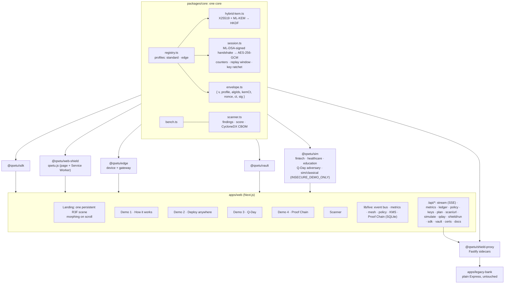

# QuantumLedger: make anything in India quantum-safe, in one line

Most post-quantum projects are a library or a slideshow. **QuantumLedger is a quantum-safe socket**: one
core, one crypto-agile algorithm registry and **five adapters**. Any website, API, app, database or
hardware device can adopt NIST's post-quantum standards without a rewrite. Those standards are
**ML-KEM** (FIPS 203) for key exchange, hybridised with X25519, and **ML-DSA** (FIPS 204) for
signatures. The expensive post-quantum handshake runs once per session, and every message after it
is AES-256-GCM, so the per-message cost is microseconds. Every number in the UI is measured live,
never quoted.

## The five adapters

| Adapter                                             | For                                       | Integration                                                                                                       |
| --------------------------------------------------- | ----------------------------------------- | ----------------------------------------------------------------------------------------------------------------- |
| **QuantumLedger Shield** (sidecar proxy)            | Any server or API, including legacy cores | `npx qsetu-shield --upstream http://localhost:4000 --listen 8443` (zero code change)                              |
| **QuantumLedger Web** (script tag + Service Worker) | Any website                               | `<script src="/qsetu.js" data-key="<key id>" data-endpoint="/api/"></script>`                                     |
| **QuantumLedger SDK** (ESM package)                 | New apps: Node, browser, React Native     | `npm i @qsetu/sdk`, then `createSession` / `seal` / `open` / `sign` / `verify` ([README](packages/sdk/README.md)) |
| **QuantumLedger Edge** (IoT profile)                | Meters, medical devices, POS terminals    | ML-KEM-512 + ML-DSA-44, a 64 KB budget, batch-signed readings                                                     |
| **QuantumLedger Vault** (data at rest)              | Databases and file stores                 | `await vault.put(record)` / `await vault.get(id)`: per-record ML-KEM-wrapped keys, ML-DSA signatures              |

## Shield: quantum-safe TLS and AI-agent defence in front of any website

`/shield` on the site, and `packages/shield-edge`, `packages/shield-guard` and `packages/shield`:

- **Shield Edge** is a reverse proxy that terminates TLS 1.3 with **X25519MLKEM768**.
  - It's native OpenSSL 3.5 through Node, not JavaScript cryptography.
  - It counts per connection whether the visitor got the post-quantum key exchange.
  - It gets certificates from Let's Encrypt and keeps their keys encrypted at rest.
  - It streams bodies to your origin over pooled keep-alive connections.
- **The defence engine** scores behaviour per IP, network block and session. Behaviour means rate, routes
  walked, failures, parallel bursts, and header and TLS fingerprint (JA4) consistency.
  - It acts in steps: a tighter limit, then a proof-of-work challenge, then a block. Repeat offenders
    are blocked for longer.
  - Honeypots, a trap link and a canary key block and alert on first touch.
  - Modes are Off, Monitor (the default for new sites), Protect and Strict.
- **Install it one of three ways:**
  1. DNS: a TXT ownership record, then a CNAME.
  2. A container: `packages/shield-edge/docker/`.
  3. One line of middleware, `app.use(shield({ siteKey }))`, for Express, Fastify or Next.js. This gives
     the defence only: post-quantum TLS needs route 1 or 2.
- **The dashboard** is at `/app`. It needs a password plus an authenticator code. It lets you add sites,
  verify DNS, copy install snippets and switch the mode. It shows live metrics, including the % of
  quantum-safe connections. It sends alerts by email and webhook, and gives a monthly PDF report.
- **`/shield/live`** attacks the legacy bank app twice, bare and behind Shield Edge, and shows the
  difference. The attack tools refuse every host but loopback.
- **Measured** (Apple M4, loopback; `docs/real/benchmarks.md`), against the budget, which fails the build
  if missed:

  | Measure                                     | Result                       | Budget        |
  | ------------------------------------------- | ---------------------------- | ------------- |
  | Added latency, warm connection              | +0.060 ms p50, +0.085 ms p95 | ≤ 2 / ≤ 10 ms |
  | Extra server CPU per post-quantum handshake | +0.030 ms                    | ≤ 1.5 ms      |
  | Edge CPU at 1,000 req/s                     | 4.1% of one core             | ≤ 10%         |

- **Honest scope.**
  - Certificates stay ECDSA, because browsers don't take post-quantum ones yet.
  - The hop from the edge to your origin is as strong as that hop's own TLS.
  - A patient agent driving a real browser looks human.
  - Injection payloads are the job of the optional OWASP CRS container.
  - Nothing here makes a site impossible to attack.

## Architecture



`@noble/post-quantum`, `@noble/curves`, `@noble/hashes` and `@noble/ciphers` supply every
primitive. Nothing cryptographic is implemented from scratch, apart from the deliberately insecure
classical stand-in in `packages/sim/src/classical/`.

## Run it

Requires Node ≥ 20.19 and pnpm 10 (`corepack enable` picks up the pinned version).

```bash
pnpm install && pnpm dev   # site + legacy app (:4000) + Shield server (:8443) + Shield client (:8080)
pnpm test                  # 105 unit tests (the ledger suite runs on SQLite and Postgres via PGlite)
pnpm build && pnpm start   # production build on :3000
pnpm test:e2e              # Playwright: every page and demo (after `pnpm build`)
pnpm test:e2e:offline      # the same site with no outbound network: scans fall back to cached results
pnpm check:budget          # home page initial JS ≤ 250 KB gzip
pnpm lhci                  # Lighthouse CI against lighthouserc.json budgets
pnpm record:demo           # re-records docs/final/demo.mp4 (the 3-minute backup video)
```

Copy `apps/web/.env.example` to `apps/web/.env.local` to set anything; everything has a working default locally.

Open these URLs:

- <http://localhost:3000>: the site (append `?present=1` for presenter mode)
- <http://localhost:3000/#scan>: "Is your bank quantum-safe?"
- <http://localhost:3000/demos>: the four demos and the scanner
- <http://localhost:3000/pitch>: seven slides, ←/→
- <http://localhost:3000/docs>: developer docs (quickstart, adapters, concepts, API reference)
- <http://localhost:3000/admin>: signups (set `ADMIN_PASSWORD`)
- <http://localhost:3000/web-shield-demo/>: a plain HTML form protected by one script tag

`pnpm dev` prints every component's logs, labelled. Watch `[legacy-app] POST /api/transfer (plain HTTP, unaware of QuantumLedger)`
while Shield carries it over PQC. With `pnpm start`, the API starts the same Shield stack in-process.

## Presenting

- **Presenter mode:** add `?present=1` to any URL. Type gets 15% larger, the nav links and footer hide, and a hint
  shows in the corner. Turn it off with Esc or `?present=0`.

  | Key   | Action                                                                        |
  | ----- | ----------------------------------------------------------------------------- |
  | → / ← | Step the current demo forward or back (on other pages, move between sections) |
  | 1–5   | How it works · Deploy · Q-Day · Proof Chain · Scanner                         |
  | R     | Reset every demo (production: sign in at `/admin` first)                      |
  | ⌘K    | Jump anywhere, or scan a site                                                 |

- **Reset all:** every demo header has a "Reset all" button (the same as R). It changes the demos for every visitor,
  so in production it needs the admin sign-in (password + authenticator code); visitors see "Admin only".
- **Offline:** start with `NEXT_PUBLIC_OFFLINE=1` (or `QSETU_OFFLINE=1` on the server). Everything runs locally, and
  URL scans of the suggested Indian sites come from pre-cached real scans, labelled with their date. If the venue
  network drops without the flag, scans of those sites fall back automatically.
- **No projector or laptop:** play `docs/final/demo.mp4` (3:05, the full judge flow recorded from the real site).
- **Slides:** `/pitch`.

## 3-minute judge script

1. **Hero (20 s).** Open <http://localhost:3000>. The strip first shows your browser generating its own ML-KEM-768
   key (timed), then streams real operations. The globe assembles; every pulse is a real packet.
2. **Is your bank quantum-safe? (30 s).** Type a bank's site, or click `onlinesbi.sbi`. The real TLS probe gives a
   score ring, the globe turns to the server, and you get three plain findings. Then click `irctc.co.in` for a
   hybrid post-quantum result. "Share result" gives a link with its own preview card.
3. **Why now (20 s).** Scroll once. _Today_: harvest now, decrypt later, with a counter of packets
   that crossed the network since you arrived. _Aug 2024_: FIPS 203/204/205. _2030 / 35_: NIST's draft
   deprecation dates. Every claim has a footnote to its primary source. Keep scrolling through
   _Harvest → Q-Day_: the year runs to 2035 and the classical rows decrypt in your browser.
4. **Demo 3 · Q-Day (35 s).** Open `/demo/qday` and press **Go to Q-Day**. The classical column's
   _exposed_ counter rolls up as your browser factors the RSA keys. The QuantumLedger column stays at 0 even
   though the attacker was handed the X25519 secrets. The console on the right shows both halves.
5. **Demo 2 · Deploy (30 s).** Open `/demo/deploy` and press **Deploy all**. Five real adapters run;
   then each sealed node keeps working and its ops counter climbs with real traffic.
6. **Proof Chain tamper (25 s).** Open `/demo/ledger`. **Verify the chain** (✓ intact). **Tamper with
   entry #42**: the demo runs a raw SQL `UPDATE`, bypassing the API. **Verify** again: _Broken at entry
   #42: row edited after it was written_. **Restore**.
7. **Why QuantumLedger (20 s).** Back on the home page, the comparison against PQC libraries, edge
   PQ-TLS and doing nothing. Libraries are the foundation (QuantumLedger is built on them); QuantumLedger is how
   India deploys them. Optional: in Demo 1, switch the policy to SLH-DSA and watch the console's
   algorithm IDs change as live sessions re-key, with no restart.

## Live backend

| Endpoint                                     | What it does                                                                                                           |
| -------------------------------------------- | ---------------------------------------------------------------------------------------------------------------------- |
| `GET /api/stream`                            | SSE from the in-process event bus: one frame per real operation, plus `event: metrics` every second                    |
| `GET /api/metrics`                           | Rolling 60 s counts and p50/p95 latency per operation, per city and per Demo 2 site                                    |
| `GET /api/ledger`, `POST /api/ledger/verify` | Proof Chain: SQLite (`better-sqlite3`), SHA3-256 hash chain, ML-DSA-65 signatures; verify names the first broken entry |
| `POST /api/scan/url`                         | Probes a public host on 443 offering `X25519MLKEM768`; reports TLS version, cipher, group, certificate; CBOM + plan    |
| `POST /api/plan`                             | Findings → ordered migration checklist (adapter, effort S/M/L, priority by data lifetime); JSON or Markdown            |
| `POST /api/policy`                           | Hot-swaps `standard` ↔ `edge` or the signature to SLH-DSA; live sessions re-key at their next rotation                 |
| `GET /api/keys`, `POST /api/keys/rotate`     | Demo KMS: keys wrapped with AES-256-GCM in a pluggable `KeyStore` (file now, HSM-ready); rotations go to the ledger    |
| `GET /api/docs`                              | OpenAPI 3.1, generated from the same zod schemas every route validates with                                            |

The live mesh (`apps/web/lib/live/mesh.ts`) runs real hybrid sessions on the globe's 12 routes, but only
while someone is watching the stream. Every error has one shape: `{ "error": { "code", "message", "issues"? } }`.
Data lives in `apps/web/.data/` (gitignored); set `QSETU_DATA_DIR`, `QSETU_KMS_KEK` (64 hex chars) and
`QSETU_ROTATE_MS` to override.

## Deploy

**Recommended: one Node container** (`Dockerfile`), on Railway, Fly.io, Render or any VM. QuantumLedger has
long-running pieces that serverless platforms can't host: the SSE event bus (`/api/stream`), the live
mesh that generates real traffic while someone watches, the scheduled KMS rotation, and the Shield demo
nodes, which bind local ports. One container runs all of them.

```bash
docker build -t q-setu .
docker run -p 3000:3000 \
  -e NEXT_PUBLIC_SITE_URL=https://your-domain.in \
  -e DATABASE_URL=postgres://...            # Neon / Supabase / Railway Postgres
  -e QSETU_KMS_KEK=$(openssl rand -hex 32)  # keep this secret and stable
  -e ADMIN_PASSWORD=... \
  q-setu
```

- **Database.** With a `postgres://` `DATABASE_URL`, the ledger, KMS keys, signups and scan results go to
  Postgres through Drizzle. Tables are created on first start; `drizzle.config.ts` can generate
  migrations instead. Without it, a SQLite file is used in `QSETU_DATA_DIR` (mount a volume).
- **Secrets and URLs.** All of them are listed with comments in `apps/web/.env.example`.
- **Vercel.** The pages, docs, scanner and APIs work, but it isn't recommended. Serverless instances
  don't share the in-process bus, the mesh only runs while a stream is open on that instance, SSE is cut
  at the function's maximum duration (the browser reconnects), and the Shield demo can't bind ports.
  If you use it anyway, use Postgres (SQLite isn't persistent there) and treat the live strip as
  best-effort.
- **CI.** `.github/workflows/ci.yml` runs lint, `lint:design`, typecheck, unit tests, the build, the
  initial-JS budget (`pnpm check:budget`), the Playwright suite and Lighthouse CI (`lighthouserc.json`).
  GitHub only reads workflows at the repository root, so if q-setu is a subfolder, move the file.

## What's real and what's simulated

**Real:**

- All post-quantum and classical primitives, via the audited `@noble` libraries.
- The hybrid combiner, the handshake (with forward secrecy and key confirmation), the record layer
  (replay window, ratcheting rotation every N messages or T minutes) and the envelope.
- **Every adapter.** Shield nodes really proxy to an Express app. `qsetu.js` really seals form posts
  in the browser, with pinned keys and signed responses. The SDK really handshakes with `/api/sdk`. Edge
  really runs in a Web Worker. Vault really detects tampering.
- The Readiness Scanner, including live TLS probing of public hosts (private and loopback addresses
  are refused) and its CycloneDX 1.6 CBOM.
- The QR code is decoded from rendered pixels, and the certificate signatures are real ML-DSA-65.
- Every benchmark and Compute Meter value, every ticker line, globe pulse and console entry: each is
  an operation that actually ran, with its measured time.
- The Proof Chain chain and its signatures, the KMS key wrapping and rotation, and the policy hot-swap.

- Shield Edge's post-quantum TLS, its per-connection metric (checked against real handshakes), the defence
  engine, the tunnel v2 and the benchmarks.

**Built but not exercised from this repository:**

- **Let's Encrypt issuance:** the flow is the maintained `acme-client`'s own, but it needs a public DNS
  name and port 80 reachable from the internet.
- **The container image:** the Dockerfile and compose file are written, but Docker wasn't available
  where they were written, so the image hasn't been built here.
- **The OWASP CRS WAF service:** it's in the compose file, in detection-only mode.
- **The ZAP baseline:** it runs per PR once `PREVIEW_URL` is set.

**Simulated (and labelled in the UI):**

- **The classical "today" system uses a ~40-bit RSA key** (`sim/classical/`, `INSECURE_DEMO_ONLY`),
  so the browser can factor it with Pollard's rho, standing in for Shor's algorithm on RSA-2048.
  The AES-256 payload encryption is real.
- **A simulated Shor oracle** hands the attacker the X25519 secrets. The simulator keeps copies only
  for this; real endpoints erase them. The attack then runs the real key schedule and fails.
- **Edge budgets.** RAM is _accounted_ (the sum of keys, buffers and session state), not a capped heap.
  CPU is throttled by spinning to emulate a 20× slower device.
- **Web shield demo keys** come from a public seed so the static page can pin a stable key ID. Set
  `QSETU_WEB_SHIELD_SEED` in production.
- Institutions, people and IDs are fictional. The Q-Day year (2033) is illustrative. The "100 ms
  typical request" behind the overhead percentage is an assumption.
- Every factual claim lives in `apps/web/data/facts.ts` as `{ claim, source, url, asOf, verified }`,
  and **only `verified: true` facts are shown**. The NIST, NCSC and NQM facts were checked against
  their sources on 2026-10-11. The UPI monthly figure and the DST quantum-safe roadmap were found
  only in secondary reporting, so they stay hidden until the team confirms them on npci.org.in and
  dst.gov.in.
- The ledger's _Tamper_ button and `POST /api/ledger/tamper` are demo-only; the KMS keeps its demo
  KEK on disk unless `QSETU_KMS_KEK` is set.
- The optional native `liboqs` benchmark was skipped. All numbers come from pure TypeScript, which is
  slower than native code, so real deployments would do better.

## Roadmap

1. **Hackathon MVP** (this repo): the core, five adapters, four demos, the scanner, Proof Chain and the website.
2. **Pilots:** a bank, a hospital and a university, each running in shadow mode.
3. **HSM + TLS 1.3:** keys move into HSMs (PKCS#11), and every link uses `X25519MLKEM768`. Shield Edge
   already does this for visitor traffic. SLH-DSA (FIPS 205, already in the registry) covers long-lived
   roots.
4. **Certification:** independent audit, plus alignment with Indian regulators (RBI, CERT-In) and
   sector bodies.

The map outline comes from Natural Earth (public domain), India point of view, simplified with
`scripts/build-india-outline.py`.
