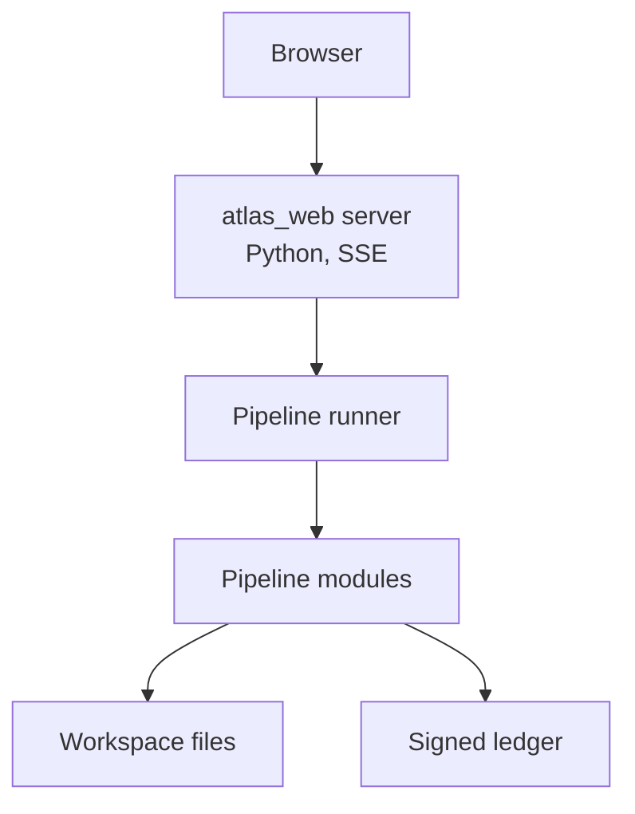
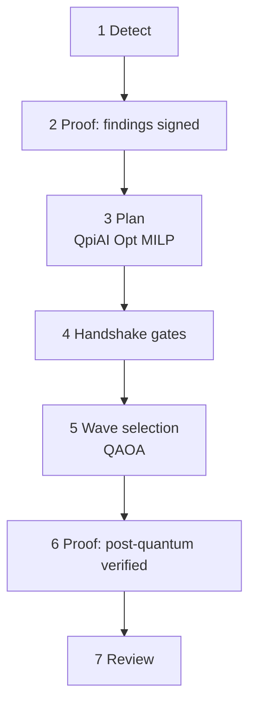
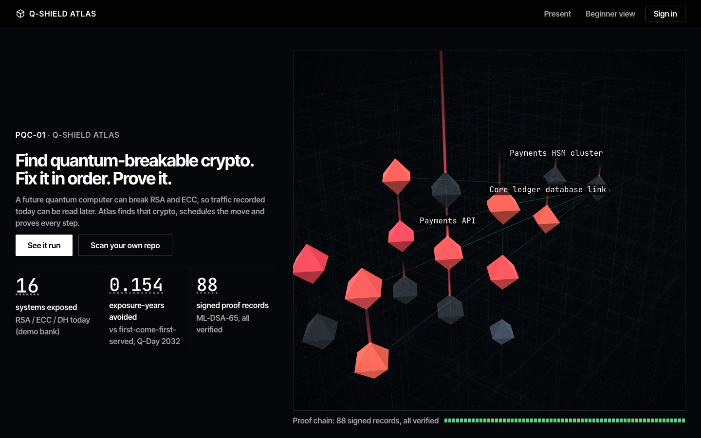
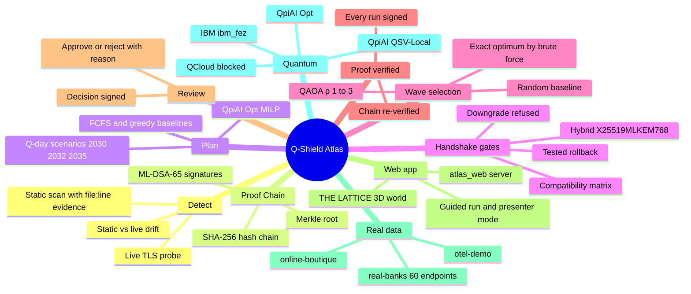

# Q-Shield Atlas

**Find quantum-breakable crypto. Fix it in order. Prove it.** Hackathon project, Post-Quantum Cryptography track, PQC-01.

## Quickstart

**macOS / Linux**

```bash
git clone https://github.com/Yojan-ui/q-shield-atlas.git && cd q-shield-atlas
conda create -y -n pqc -c conda-forge python=3.12 openssl=3.6.5 && conda activate pqc
pip install -r requirements.txt
python -m atlas_web create-user --role admin
./run.sh                    # then open http://127.0.0.1:8100
```

**Windows (Anaconda Prompt)**

```bat
git clone https://github.com/Yojan-ui/q-shield-atlas.git && cd q-shield-atlas
conda create -y -n pqc -c conda-forge python=3.12 openssl=3.6.5 && conda activate pqc
pip install -r requirements.txt
python -m atlas_web create-user --role admin
run.bat                     &:: then open http://127.0.0.1:8100
```

Tested on macOS. On Windows, use WSL if anything fails. Without QpiAI keys the app runs on the local simulator and shows
the recorded results. Starting a new pipeline run needs a free `QPIAI_OPT_API_KEY` in `.env.sh` (copy `.env.example`).

## Architecture

**A. How a run flows**



- The server binds 127.0.0.1; login, roles and CSRF guard every write ([docs/API.md](docs/API.md)).
- The runner starts one subprocess per step, and its live log streams to the browser.
- Modules exchange only JSON files validated by `contracts/`; each run is signed with ML-DSA-65.

**B. The 7 steps**



- The order comes from `contracts/stages.json`, shared by `run_demo.sh`, the runner and the UI.
- Gates run on real TLS 1.3 lab services; QAOA is a cross-check against the exact optimum, with no advantage claimed.
- Full diagram, stages and solvers: [docs/ARCHITECTURE.md](docs/ARCHITECTURE.md).

**Backend**

| COMPONENT | FOLDER | WHAT IT DOES |
|---|---|---|
| Web server | `atlas_web/` | Login-protected UI and JSON API; runs the pipeline per workspace |
| Detect | `detect/` | Finds RSA / ECC / DH with file:line evidence, plus a live TLS probe |
| Schedule | `schedule/` | Weekly wave plan: QpiAI Opt MILP vs FCFS and greedy |
| Gates | `gates/` | Per-wave PQ handshake, downgrade, compatibility and rollback checks |
| Capture | `capture/` | OpenSSL 3.6.5 lab TLS services and handshake evidence |
| Ledger | `ledger/` | SHA-256 hash chain, Merkle root, ML-DSA-65 signatures |
| QAOA | `qaoa/` | Wave cutover choice on QpiAI QSV-Local and numpy vs the exact optimum |


-blue)



> Lab demo · TLS lab services on 127.0.0.1 · local single-key test ledger · simulator-scale QAOA, no quantum advantage
> claimed · risk, effort and shelf-life values are assumptions (`config/assumptions.json`). No key recovery, factoring
> or decryption is performed or claimed anywhere.

## Contents

- [Quickstart](#quickstart)
- [Architecture](#architecture)
- [The problem in 30 seconds](#the-problem-in-30-seconds)
- [What Q-Shield Atlas does](#what-q-shield-atlas-does)
- [Mind map](#mind-map)
- [Backend: atlas_web server + pipeline modules](#backend-atlas_web-server--pipeline-modules)
- [Frontend](#frontend)
- [Real data](#real-data)
- [Quantum](#quantum)
- [Optimizer comparison](#optimizer-comparison)
- [Full setup](#full-setup)
- [Honesty and safety rules](#honesty-and-safety-rules)
- [Testing](#testing)
- [Repo layout](#repo-layout)
- [Team](#team)
- [License](#license)

QpiAI / QCloud usage log (plain text): [docs/QPIAI_QCLOUD.txt](docs/QPIAI_QCLOUD.txt) · recorded QpiAI call log from the web app: [docs/QPIAI_USAGE_LOG.txt](docs/QPIAI_USAGE_LOG.txt)

More detail: [docs/ARCHITECTURE.md](docs/ARCHITECTURE.md) · [docs/BACKEND.md](docs/BACKEND.md) ·
[docs/API.md](docs/API.md) · [docs/QUANTUM.md](docs/QUANTUM.md) · [docs/REFERENCE.md](docs/REFERENCE.md) (module internals,
assumptions, pins) · [DEMO.md](DEMO.md) (demo script).

## The problem in 30 seconds

- **Harvest now, decrypt later.** Traffic protected by RSA or elliptic-curve key exchange can be recorded today and read
  once a large quantum computer exists.
- **It is still common.** 46 of 60 public Indian bank endpoints we observed (one TLS handshake each, 2026-10-29)
  negotiated classical key exchange. 12 negotiated hybrid post-quantum, and 2 were unreachable
  (`data/real_banks/scan_2026-10-29.csv`).
- **Migration takes time and order matters.** Systems depend on each other, teams have weekly capacity, and the
  most sensitive data should leave classical crypto first.

## What Q-Shield Atlas does

| # | Step | One line |
|---|---|---|
| 1 | **Detect** | Find RSA / ECC / DH in code, configs and certificates (file:line evidence), plus live TLS probes and drift |
| 2 | **Prove** | Sign the Detect evidence into an ML-DSA-65 hash-chained Proof Chain before anything else runs |
| 3 | **Plan** | Schedule the migration in weekly waves with a QpiAI Opt MILP, compared with FCFS and greedy |
| 4 | **Test** | Gate each wave on real TLS 1.3 lab services: hybrid X25519MLKEM768, downgrade refused, compatibility, rollback |
| 5 | **Cross-check** | Check one week's cutover choice with QAOA on simulators against the exact optimum |
| 6 | **Verify** | Sign every result and re-verify the whole chain |
| 7 | **Review** | A person approves or rejects each result; the decision is signed too |

## Mind map



## Backend: atlas_web server + pipeline modules

| COMPONENT | FOLDER | TECH | WHAT IT DOES |
|---|---|---|---|
| Web server | `atlas_web/` | Python 3.12 stdlib HTTP server, Server-Sent Events, SQLite users and sessions, scrypt passwords, CSRF double-submit, login rate limit | Login-protected UI and JSON API on 127.0.0.1; workspaces under git-ignored `atlas_web/data/workspaces/<id>/` |
| Runner | `atlas_web/runner.py` | subprocesses with timeouts | Runs the pipeline CLIs per workspace and streams the log; crash recovery marks interrupted runs |
| Detect | `detect/` | static scanner + OpenSSL `s_client` probe | Inventory of RSA / ECC / DH with file:line evidence; live handshake probe; drift |
| Schedule | `schedule/`, `solvers/` | QpiAI Opt MILP (local), FCFS and greedy baselines | Weekly wave plan minimising weighted exposure under several Q-day scenarios |
| Capture | `capture/` | OpenSSL 3.6.5 `s_server` / `s_client -brief -msg` | Real TLS 1.3 lab services (legacy X25519, hybrid X25519MLKEM768) and handshake evidence |
| Gates | `gates/` | handshake group allowlist, compatibility matrix | Per-wave checks: PQ handshake, downgrade refused, compatibility, tested rollback |
| Ledger | `ledger/` | SHA-256 hash chain, RFC 6962 Merkle root, ML-DSA-65 via the OpenSSL CLI | Signs every run manifest; verification detects any edit |
| QAOA | `qaoa/` | numpy statevector, QpiAI QSV-Local (`qpiai-quantum` 0.3.0); QCloud status | Link cutover selection (≤ 16 variables) vs the exact optimum and a random baseline |
| Benchmark | `bench/` | same solvers on 6–16-variable instances | Classical vs quantum vs hybrid: gap to optimum and runtime |
| Contracts | `contracts/` | JSON Schema | Validates every module output, assembles `results.json`, holds the stage list |

### API endpoints

Selected routes; every route is in [docs/API.md](docs/API.md).

| METHOD | PATH | PURPOSE | ROLE |
|---|---|---|---|
| GET | `/api/health` | liveness | public |
| POST | `/api/auth/login` · `/api/auth/logout` | session cookies + CSRF cookie | public · signed in |
| GET | `/api/me` · `/api/stages` | current user · stage list | public |
| GET | `/api/quantum/status` | QpiAI QCloud login, devices, blocker reason | viewer |
| GET | `/api/workspaces` | list workspaces | viewer |
| GET | `/api/workspaces/<ws>/results` | `results.json` | viewer (public for `demo`) |
| GET | `/api/workspaces/<ws>/ledger` | Proof Chain entries + live verification | viewer (public for `demo`) |
| POST | `/api/workspaces/<ws>/clone` | shallow clone of a public repository | operator |
| POST | `/api/workspaces/<ws>/runs` | start the pipeline | operator |
| GET | `/api/workspaces/<ws>/runs/<id>/events` | live run log (SSE) | viewer |
| POST | `/api/workspaces/<ws>/reviews` | sign a review decision | operator |
| GET / POST | `/api/users` | list / create users | admin |

## Frontend

- **Stack:** plain ES modules, no framework and no build step (`atlas_web/static/`). three.js 0.170.0 is vendored
  and hash-checked (`viz/vendor/MANIFEST.json`). THE LATTICE is one persistent 3D world, with a 2D fallback without
  WebGL.
- **Pages, in the 7-step order:** Overview → 1 Detect (plus Inventory & drift) → 2 Proof: findings signed → 3 Plan →
  4 Handshake gates → 5 Wave selection → 6 Proof: post-quantum verified → 7 Review. Also Migration, Benchmark and
  Glossary.
- **Guided run:** "Run pipeline" on a workspace opens a full-width 3D run with its live log, and "Replay last run"
  replays it.
- **Presenter mode:** press P or click Present.
- **Beginner / Expert view:** Beginner hides the technical details.
- **Offline export:** `python -m atlas_web export` writes a static read-only snapshot to `atlas_web/dist/` that works
  over `file://`.

## Real data

| Workspace | Source | Real | Simulated | Headline numbers |
|---|---|---|---|---|
| `real-banks` | 60 public Indian bank endpoints from the CC0 [bank-in-domains](https://github.com/CCAgentOrg/bank-in-domains) dataset (commit `7b161ae`) | one TLS 1.3 handshake per endpoint (2026-10-29) | the migration plan (planned, never applied) | 46 classical · 12 hybrid PQ · 2 unreachable; 58 systems, 101 findings, 20-week plan |
| `online-boutique` | Google's microservices demo, pinned commit (`detect/real_repos.json`) | static scan of the real source | lab stand-ins for its services | 3 systems, 4 findings, 2-week plan |
| `otel-demo` | OpenTelemetry demo, pinned commit | static scan of the real source | none needed | 0 systems to migrate: an honest empty plan |
| `demo` | `data/SYNTHETIC_mock_bank_assets.csv`: a fictional 16-asset bank (**synthetic**) | TLS handshakes on the lab services | the inventory itself | 16 systems, 29 vulnerable findings, 7-week plan |

The workspace numbers come from each workspace's `out/results.json` (runs of 2026-10-29). Column meanings are in
`data/DATA_DICTIONARY.md`, and the input/output hashes are in `data/sources.json`.

## Quantum

No quantum advantage is claimed: QAOA is a measured cross-check against the exact optimum. Full detail and
reproduction: [docs/QUANTUM.md](docs/QUANTUM.md).

| Backend | Used for | Recorded status |
|---|---|---|
| QpiAI Opt 0.0.9 (local) | scheduling MILP | optimal, 0.1215 s, run `641f5d49…`; `job_id: null` because local solves issue no job ID |
| QpiAI QSV-Local (`qpiai-quantum` 0.3.0) | QAOA wave selection, 14 variables | P(optimal set) 0.0137 / 0.0186 / 0.0171 at p = 1 / 2 / 3, against 0.0010 for random |
| QpiAI QCloud | cloud simulator sampling | login and device listing work; job creation was rejected on 2026-10-28 with "an active subscription is required to run jobs", so no QCloud job exists |
| IBM `ibm_fez` (real hardware) | the same QAOA circuits, sampled once per p | 3 jobs on 2026-10-29; P(optimal set) 0.0088 / 0.0044 / 0.0029; hardware noise lowers feasibility |

QpiAI-Indus-1 (QPU) is refused by code in every mode. Platform and QCloud runs are opt-in and disabled
(`config/atlas_web.json`).

## Optimizer comparison

`python -m bench` solves the same link cutover instances (6–16 variables) with every method. Values at the largest
size, 16 variables (`out/bench.json`, run `f1e23e14…`, 2026-10-29):

| Method | Family | Optimal? | Runtime at 16 variables |
|---|---|---|---|
| Exact (brute force) | classical | proven optimum | 0.0032 s |
| MILP (QpiAI Opt) | classical | proven optimum (MILP gap 0) | 0.1171 s |
| Random sampling | baseline | found it, no guarantee | 0.0311 s |
| QAOA p = 1 / 2 / 3 (numpy) | quantum (simulator) | found it, no guarantee | 7.62 / 13.96 / 20.43 s |
| QAOA p = 1 (QpiAI QSV-Local) | quantum (simulator) | found it, no guarantee | 0.0422 s |
| Hybrid (QAOA + classical repair) | hybrid | always feasible, optimum not guaranteed | 7.72 s |
| Hardware | quantum (hardware) | not run in the benchmark (QCloud blocked; Indus-1 never used) | – |

**Why MILP for the full schedule:**
- It proves optimality (gap 0) with capacity and dependencies modelled exactly.
- The full 16-asset plan solved in 0.1215 s locally.
- QAOA cannot hold the full schedule: it has |assets| × horizon binaries plus continuous exposure variables, and QAOA
  here is capped at 16 qubits.

## Full setup


```bash
# 1. Environment: Python 3.12 + OpenSSL 3.6.5 + the pinned QpiAI SDKs (qpiai-opt 0.0.9, qpiai-quantum 0.3.0)
conda env create -f environment.yml && conda activate pqc
pip install -r requirements.txt

# 2. Keys (git-ignored): QPIAI_OPT_API_KEY (free at https://opt.qpiai.tech/), QCLOUD_API_KEY
source .env.sh

# 3. Regenerate the demo snapshot (local only; also attaches the recorded IBM run, --no-ibm skips it)
./run_demo.sh --no-open

# 4. Web app: create the first user (no default user), then start the server
python -m atlas_web create-user --role admin
python -m atlas_web --port 8100 --no-browser      # open http://127.0.0.1:8100/

# 5. Real workspaces: clone the pinned repos and run them through the same API
python tools/seed_real_workspaces.py --confirm    # online-boutique, otel-demo
python tools/scan_banks.py publish                # real-banks from data/real_banks/

# 6. Tests
pytest
node --test atlas_web/jstests/*.test.mjs
python tools/route_check.py                       # every route x 3 sizes x 4 roles in headless Chrome

# 7. Offline export (static, read-only, works over file://)
python -m atlas_web export
```

More options (venv instead of conda, kiosk mode, single-module reruns, opt-in paid runs):
[docs/REFERENCE.md](docs/REFERENCE.md) and [docs/BACKEND.md](docs/BACKEND.md).

## Honesty and safety rules

- Every number in the UI and docs comes from a logged run: timestamp, input hashes, solver output, and a job ID or
  `null` with the reason.
- No quantum advantage claimed; QAOA is a cross-check against the exact optimum.
- No key recovery, factoring or decryption. Classical sessions are labelled "HNDL-exposed: recorded traffic relies on
  classical key exchange".
- Risk, effort and shelf-life values are assumptions, shown as such, with a sensitivity test.
- Nothing is reported "applied" or "passed" without gate evidence; unmapped assets are `not_verified_in_lab`.
- Lab services bind 127.0.0.1 only; handshake capture never uses `-keylogfile` or SSLKEYLOGFILE.
- Paid QpiAI runs are opt-in, logged, capped at 10 per UTC day, and must name a simulator; QpiAI-Indus-1 is refused.
- Keys stay in git-ignored `.env.sh` and `keys/` and are never printed, logged or committed.

## Testing

| Suite | Command | Last result |
|---|---|---|
| Python | `pytest` | 519 passed, 3 skipped |
| Frontend unit | `node --test atlas_web/jstests/*.test.mjs` | 54 passed |
| Browser routes | `python tools/route_check.py` | 312 page loads, 0 with problems |

Some tests need the network (GitHub clone, public PQ reference servers) and skip when offline. QpiAI solver tests
skip without `QPIAI_OPT_API_KEY`.

## Repo layout

```
atlas/        report (out/report.html), terminal launch screen, showcase site server
atlas_web/    web app: server, runner, auth, workspaces; static/ frontend; jstests/
bench/        classical vs quantum vs hybrid benchmark
capture/      OpenSSL lab TLS services and handshake evidence
config/       assumptions, lab, QAOA, solver and web settings (policy, not measurements)
contracts/    JSON schemas, stage list, results assembly
data/         real datasets (real_*) and the synthetic demo inventory (SYNTHETIC_*)
detect/       static scan, live probe, drift
docs/         architecture, backend, API, quantum, reference
gates/        per-wave checks and rollback
ledger/       ML-DSA-65 signed hash chain and Merkle proofs
qaoa/         QUBO, QAOA simulators, QCloud and IBM runners, IBM import
schedule/     MILP model, baselines, platform guard
site/         earlier static showcase site (kept as is)
solvers/      one solve() entry point per subproblem
tests/        pytest suite
tools/        route/UI checks, seeding, bank scan, exports
viz/          earlier 2D/3D exposure viz (vendored three.js lives here)
pqc_*.py      early QpiAI Opt prototype scripts
```

## Team

Team Q-Shield Atlas. Built for the NITTE hackathon, Post-Quantum Cryptography track, problem statement PQC-01.
Repository: https://github.com/Yojan-ui/q-shield-atlas

## License

No license file is included in this repository yet. Third-party code keeps its own license (three.js:
`viz/vendor/three-LICENSE.txt`).
